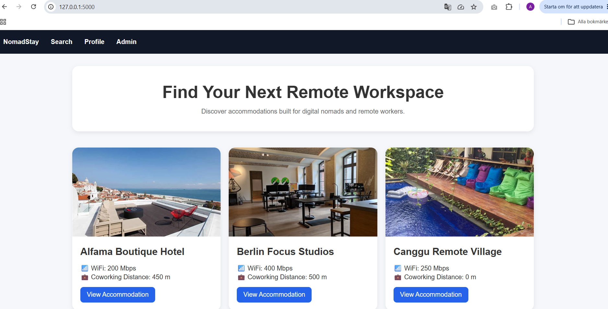
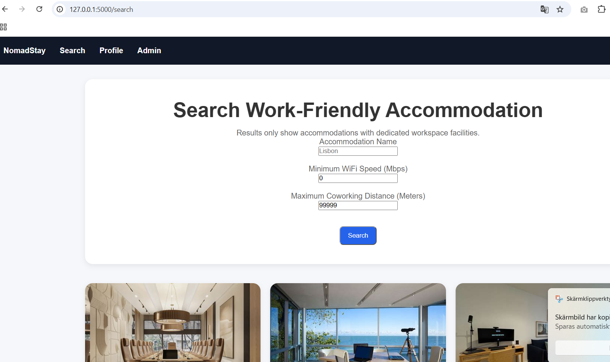
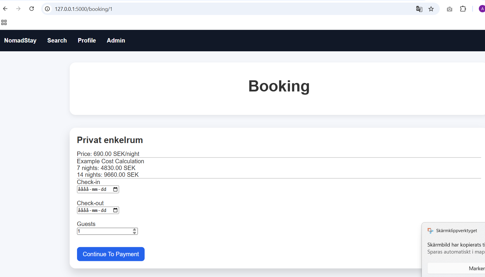
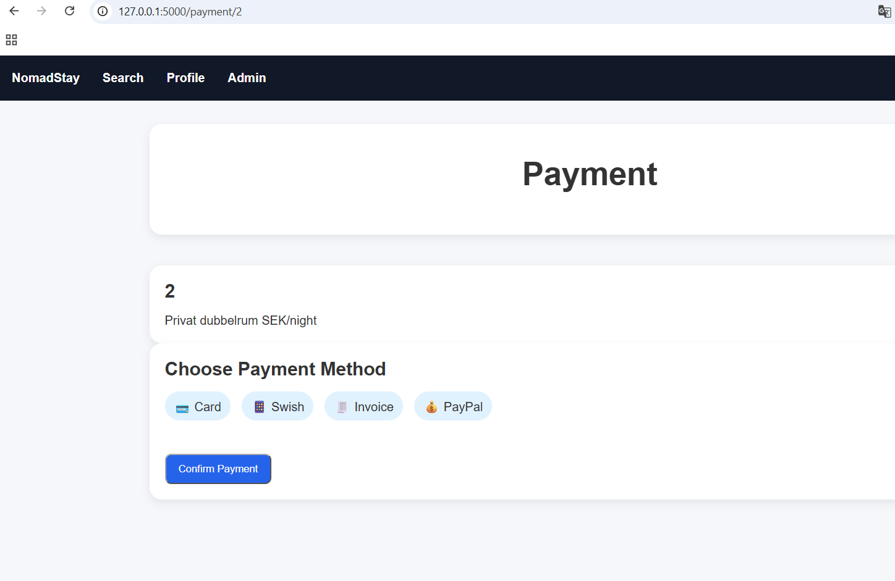

# NomadStay

NomadStay is a database-driven booking platform designed for digital nomads, remote workers, freelancers, and business travelers.

Originally developed as a Scrum team project and later continued as an individual portfolio project by Aleksandar Koyev.

---

## Project Goal

NomadStay helps remote workers find accommodations that support productive work and long-term stays by focusing on:

- Verified WiFi information
- Workspace-friendly accommodations
- Coworking proximity
- Long-term stay options
- Reviews and ratings
- Booking and payment management

---

## Development Process

The project followed a complete systems development process:

Interviews  
→ User Stories  
→ BDD Scenarios  
→ Individual ER Diagrams  
→ Group ER Diagram  
→ Mermaid ER Diagram  
→ MySQL Database Implementation  
→ Reverse Engineering  
→ SQL Query Wireframes  
→ UI Design  
→ Flask Web Application Development

---

## Features

### Implemented

- Accommodation search
- WiFi-based filtering
- Coworking distance filtering
- Accommodation details
- Workspace information
- Dynamic accommodation images
- Room selection
- Booking flow
- Payment flow
- MySQL database integration
- Flask web application

### Planned

- Booking cost calculation
- Advanced workspace filters
- User profile dashboard
- Admin dashboard
- Booking history
- Favorites management

---

## Technology Stack

### Frontend

- HTML5
- CSS3
- Jinja2

### Backend

- Python
- Flask

### Database

- MySQL

### Version Control

- Git
- GitHub

---

## Repository Structure

```text
database/
├── SQL schema
├── migration scripts
└── validation queries

diagrams/
├── individual ER diagrams
├── group ER diagram
├── Mermaid ER diagram
└── reverse-engineered model

docs/
├── project documentation
├── project roadmap
└── contribution overview

wireframes/
└── interactive SQL query wireframes

ui-design/
└── user interface concepts

website/
├── Flask application
├── templates
├── static
└── MySQL integration
```

---

## Current Project Status

### Completed

- Database design
- Database implementation
- Database audit and validation
- Flask setup
- MySQL integration
- Homepage
- Search page
- Accommodation page
- Booking flow
- Payment flow
- Dynamic image handling

### In Progress

- Booking calculations
- User profile functionality
- Advanced search filters

---

## Screenshots

### Homepage



### Search



### Accommodation Details


### Booking



### Payment


## Author

Aleksandar Koyev

Individual continuation and portfolio version of the NomadStay project.
